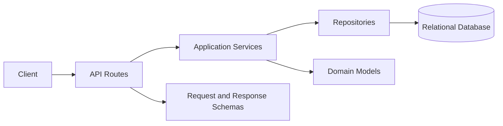
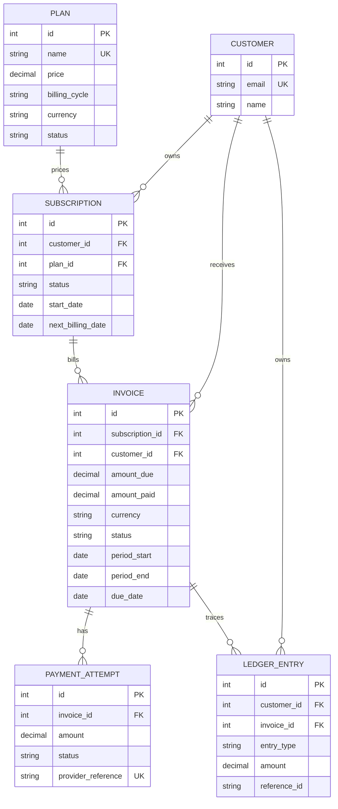

# SubLedger Low-Level Design

## Learning Goals From the Sessions

| Session concept | How it is demonstrated in SubLedger |
| --- | --- |
| Low-level design | The billing domain is decomposed into entities, services, repositories, API routes, and workflows before implementation. |
| SOLID principles | Plan, customer, subscription, invoice, payment, and ledger responsibilities are separated into focused services and models. |
| Repository Pattern | Database reads and writes are isolated in repository classes instead of being embedded in routes or business workflows. |
| Service layer | Business rules and multi-step billing workflows live in services, not controllers/routes. |
| Dependency management | FastAPI dependencies inject request-scoped database sessions and repositories into services. |
| Production basics | Environment-based configuration, `.env.example`, Docker, CI validation, and documented run instructions provide a production-oriented foundation. |

## Product Scope

| In scope | Out of scope |
| --- | --- |
| Plan management, customer management, and subscription lifecycle. | Real payment gateway integration; payment status is recorded by the API and no funds are processed. |
| Invoice generation, payment-attempt recording, and an append-only ledger. | Frontend UI, complex taxation, and proration. |
| Billing validation, API documentation, and local Docker setup. | Authentication/RBAC in the base implementation; it may be added as a bonus. |

## Architecture

The HTTP layer validates requests and selects services through FastAPI dependencies. Those dependencies inject a request-scoped SQLAlchemy session and the required repositories. Services own business workflows and transaction boundaries. Repositories own SQLAlchemy queries and persistence operations. SQLAlchemy models map the domain to relational tables; Pydantic schemas define the API contract. Configuration and session creation are centralized in `app/core` and `app/db.py`.

## Entity Relationship Diagram

## Services

| Service | Owns | Does not own |
| --- | --- | --- |
| `PlanService` | Plan create/update/list/deactivate and duplicate-name conflicts | Subscription eligibility |
| `CustomerService` | Customer create/list/fetch, email normalization, and duplicate-email checks | Ledger writes |
| `SubscriptionService` | Customer/plan existence, active-plan check, duplicate active subscription prevention, creation, and cancellation | Invoice pricing |
| `InvoiceService` | Active subscription validation, billing period and price snapshot, invoice creation, next billing date advancement, and invoice-created ledger request | Payment outcomes |
| `PaymentService` | Currency/balance validation, attempt creation, successful invoice balance/status updates, failure handling, and payment ledger request | Gateway calls or settlement |
| `LedgerService` | Append ledger entries and customer history reads | Mutating/deleting existing entries |

Plan price and billing-cycle request validation is performed by `PlanCreate` (`price > 0`, `monthly` or `yearly`); the database also checks positive plan price. Service responsibilities above distinguish those boundary validations from workflow and state-transition logic.

## Repositories

| Repository | Entities read/written | Common methods |
| --- | --- | --- |
| `PlanRepository` | `Plan` | `get`, `get_by_name`, `list`, `add` |
| `CustomerRepository` | `Customer` | `get`, `get_by_email`, `list`, `add` |
| `SubscriptionRepository` | `Subscription` | `get`, `get_active_for_customer_plan`, `list`, `add` |
| `InvoiceRepository` | `Invoice` | `get`, `get_for_period`, `add` |
| `PaymentAttemptRepository` | `PaymentAttempt` | `add` |
| `LedgerRepository` | `LedgerEntry` | `add`, `list_for_customer` |

Repositories do not decide business rules. Services use a shared request-scoped SQLAlchemy session and commit each complete business operation, including its ledger event, atomically.

## Business Rule Ownership

| Rule | Enforcement |
| --- | --- |
| Plan price is greater than zero | `PlanCreate` schema and `plans.price` database check constraint |
| Customer email is unique | `CustomerService` check and database unique constraint |
| Inactive plans cannot be subscribed to | `SubscriptionService` |
| No duplicate active subscription for a customer and plan | `SubscriptionService` and a partial unique index on active rows (SQLite/PostgreSQL) |
| Invoice amount comes from the plan at issue time | `InvoiceService` copies price and currency onto `Invoice` |
| Successful payment cannot exceed outstanding balance | `PaymentService` plus invoice amount range check |
| Success updates `amount_paid`; failure does not | `PaymentService` |
| Invoice state reflects payment total | `PaymentService`: `partially_paid` or `paid` |
| Ledger is append-only at the service/API boundary and traceable | `LedgerService` only exposes inserts/reads; `reference_id` is persisted and indexed |

## Design Pattern

The Repository Pattern separates persistence queries from domain workflows. FastAPI dependencies compose repositories and inject them, along with the session, into services rather than constructing dependencies in route handlers. This keeps business decisions testable without making API routes responsible for database details. SQLAlchemy session transactions are shared across repositories in a workflow so invoice/payment and ledger writes commit together.

## Invoice Generation Flow

1. `POST /invoices/generate` validates the subscription identifier and optional paired period dates.
2. `InvoiceService` fetches the subscription, requires it to be active, then fetches its plan.
3. It uses the supplied period or computes a cycle from `next_billing_date`, with the plan price/currency copied as the invoice snapshot.
4. `InvoiceRepository` inserts the issued invoice; the period uniqueness rule prevents duplicate invoices.
5. `LedgerService` inserts `invoice_created` with `invoice:<id>` as its reference in the same transaction.
6. The next billing date advances when the generated period begins at or after the current next billing date.

## Payment Recording Flow

1. `POST /payments/record` supplies invoice, amount, currency, result, and provider reference.
2. `PaymentService` fetches the invoice, validates currency and any successful amount against its outstanding balance.
3. It inserts a payment attempt. Failed attempts retain their reason and do not change `amount_paid`; successful attempts update the total and set `partially_paid` or `paid`.
4. `LedgerService` records `payment_failure` or `payment_success` using the provider reference.
5. The attempt, invoice update, and ledger entry commit as one transaction; response includes both attempt and invoice.

## API

| Method | Path | Purpose |
| --- | --- | --- |
| `POST` | `/plans` | Create plan |
| `GET` | `/plans` | List plans |
| `PUT` | `/plans/{plan_id}` | Update plan |
| `POST` | `/plans/{plan_id}/deactivate` | Deactivate plan |
| `POST` | `/customers` | Create customer |
| `GET` | `/customers` | List customers |
| `GET` | `/customers/{customer_id}` | Fetch customer |
| `GET` | `/customers/{customer_id}/ledger` | Fetch ledger history |
| `POST` | `/subscriptions` | Create subscription |
| `GET` | `/subscriptions` | List subscriptions |
| `PATCH` | `/subscriptions/{subscription_id}/cancel` | Cancel subscription |
| `POST` | `/invoices/generate` | Generate invoice |
| `GET` | `/invoices/{invoice_id}` | Fetch invoice |
| `POST` | `/payments/record` | Record payment attempt |

## Assumptions and Limitations

- Billing cycles are monthly or yearly. A generated invoice covers one cycle by default; callers may supply both period dates.
- Tax, proration, refunds, payment gateways, authentication/authorization, and background recurring billing are out of scope.
- Ledger immutability is enforced through the application interface; deployments needing tamper resistance should add database permissions or an audit/WORM store.
- SQLite is the local default. Set `DATABASE_URL` for another SQLAlchemy-supported relational database.
- `create_all` is suitable for this starter project; production schema changes should use migrations such as Alembic.
